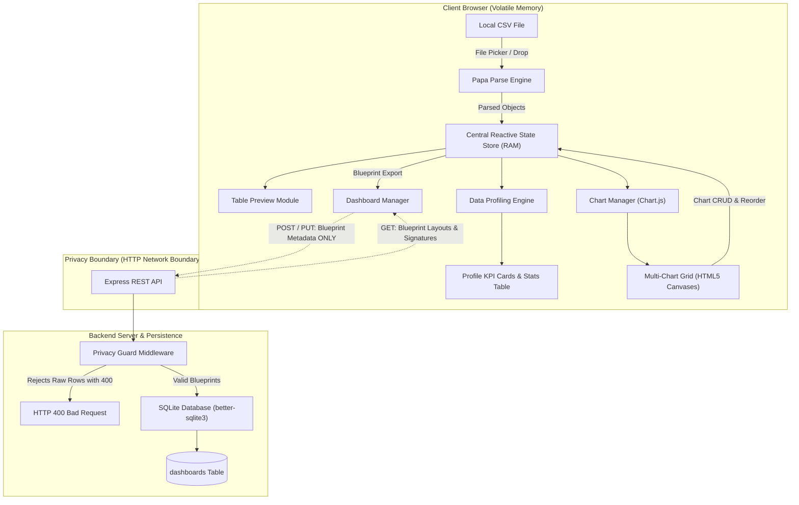
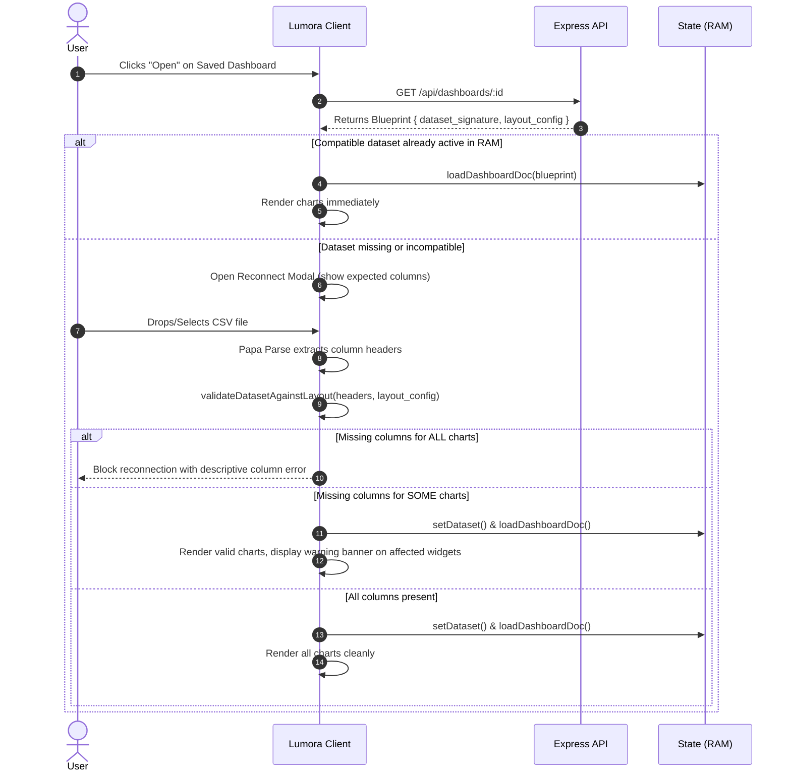

# Lumora Architectural Specification

> **Privacy-first, client-side CSV analytics studio and dashboard builder.**

---

## 1. System Overview

Lumora is engineered around a core architectural invariant: **User data never leaves the client.**

Unlike conventional BI and analytics platforms where datasets are streamed to a backend database or SaaS analytics cloud, Lumora divides responsibilities strictly across an impenetrable privacy boundary:
- **Client Browser**: Ingestion, parsing, data validation, column type inference, statistical profiling, aggregation, and canvas rendering.
- **Backend Server (Node.js & SQLite)**: Serves static code assets and acts as a blueprint store for dashboard titles, schema signatures, and chart layout specifications.



---

## 2. Browser-Side CSV Processing & Papa Parse

### Local Ingestion Pipeline
- **Dropzone & File Input**: Files selected via drag-and-drop or the file picker are received as native `File` or `Blob` handles.
- **Memory Execution**: The file is passed directly to `Papa.parse()`, executing inside the browser thread. Zero HTTP requests are dispatched during file ingestion.
- **Greedy Blank Line Skipping**: Configured with `skipEmptyLines: 'greedy'` and `header: true` to reliably handle irregular line terminations, quoted commas, and trailing newlines.
- **Dynamic Typing Preservation**: Values are initially retained as trimmed raw strings to preserve exact formatting in the preview table, with numerical conversion performed on-demand during profiling and aggregation.
- **Sample Dataset**: Includes a built-in 50-row Superstore sales CSV string wrapped in a `Blob` to allow instantaneous 1-click evaluation without local files.

---

## 3. Data Profiling & Statistical Engine

The Data Profiler (`public/js/modules/dataProfiler.js`) evaluates dataset fields in pure JavaScript without external dependencies:

### Column Type Inference
Analyzes up to 200 non-missing sample values to classify columns:
1. **Numeric**: $\ge 80\%$ of values parse as valid finite numbers (after stripping currency symbols `$` `€` `£` and formatting commas).
2. **Date**: $\ge 80\%$ of values match standard date patterns (ISO 8601 `YYYY-MM-DD`, `MM/DD/YYYY`, `DD/MM/YYYY`). Standalone integers (e.g. `2024` or `100`) are excluded to prevent false positives.
3. **Categorical**: Low cardinality ratio ($\le 25$ unique entries or $\le 35\%$ unique-to-row ratio) with short average string length ($\le 30$ characters).
4. **Text**: Freeform strings, long descriptions, or unstructured text.

### Missing Value & Descriptive Statistics
- **Missing Value Detection**: Detects `null`, `undefined`, empty strings, whitespace-only strings, `"N/A"`, `"null"`, and `"NaN"`. Numeric zero (`0`) is correctly treated as valid data.
- **Numeric Statistics**: For each numeric column, computes count, minimum, maximum, arithmetic mean, and median:
  $$\text{Mean} = \frac{1}{n} \sum_{i=1}^n x_i, \quad \text{Median} = \begin{cases} x_{(n+1)/2} & \text{if } n \text{ is odd} \\ \frac{x_{n/2} + x_{n/2+1}}{2} & \text{if } n \text{ is even} \end{cases}$$
- **UI Integration**: Summaries are rendered into KPI dimension cards, missing-percentage indicator pills, and a column table with mini progress bars.

---

## 4. Chart.js Visualization & Multi-Chart Lifecycle

### Multi-Chart Grid Architecture
The visual dashboard (`public/js/modules/dashboardGrid.js`) hosts multiple independent chart widgets rendered on distinct HTML5 `<canvas>` elements inside a responsive CSS Grid:
- **Unique Identification**: Each widget is assigned a unique identifier (`chart-<timestamp>-<hash>`).
- **Independent State**: Each chart card maintains its own title, chart type, X-axis, Y-axis, and aggregation method. Changing or deleting one chart has zero side-effects on peer widgets.
- **Supported Chart Types**:
  - **Bar**: Categorical comparisons sorted descending by metric value.
  - **Line**: Trend visualizations sorted chronologically / naturally along the X-axis.
  - **Pie & Doughnut**: Proportional distributions with automatic consolidation of slices beyond the top 8 into an consolidated `"Other"` slice.

### Aggregation Pipeline
The `aggregateData()` function aggregates row arrays into category buckets:
- `sum`: Accumulates metric values.
- `avg`: Computes arithmetic mean per category bucket.
- `count`: Computes total row frequency per category bucket.

### Lifecycle Management & Memory Safety
To prevent canvas leaks, animation timer conflicts, and Chart.js hover ghosting:
1. When a chart is edited or re-rendered, `destroyChart(chartId)` invokes `.destroy()` on the underlying `Chart` instance and removes it from the internal instance registry.
2. When the dashboard grid is reordered, rebuilt, or cleared, `destroyAllCharts()` cleans up all active canvas instances.

---

## 5. Centralized Frontend State Management

Lumora implements a centralized reactive state store (`public/js/state.js`) inspired by the Flux pattern:

```
  +------------------------------------------------------------+
  |                        state Store                         |
  |                                                            |
  |  - dataset: { fileName, fileSize, fields, data, profile }  |
  |  - activeDashboard: { id, title, description, charts: [] } |
  |  - isDirty: boolean                                        |
  |  - pendingReconnection: object                             |
  |  - pagination: { currentPage, pageSize, filterQuery }      |
  |                                                            |
  |  Methods:                                                  |
  |    addChart(), updateChart(), removeChart(), moveChart(),  |
  |    markDirty(), markClean(), setDataset(), clearWorkspace()|
  +------------------------------------------------------------+
                                |
                   notify(event, payload)
                                |
            +-------------------+-------------------+
            |                   |                   |
            v                   v                   v
      DashboardGrid        TablePreview        ProfilerUI
```

- **Clean vs. Dirty Tracking**: Any layout mutation (adding charts, updating axes, renaming, reordering, deleting) calls `markDirty()`, switching the toolbar indicator to `"Unsaved changes"`.
- **Saving / Restoring**: Successfully persisting to SQLite or loading a saved dashboard calls `markClean()`, restoring the status to `"All changes saved"`.
- **Navigation Interception**: The `beforeunload` event handler queries `state.isDirty` and triggers the browser's native leave confirmation dialogue only when unsaved edits exist.

---

## 6. Express API & SQLite Persistence

### SQLite Schema (`better-sqlite3`)
Dashboard blueprints are stored in `server/db/insightboard.sqlite` using SQLite configured in WAL (Write-Ahead Logging) mode:

```sql
CREATE TABLE IF NOT EXISTS dashboards (
  id TEXT PRIMARY KEY,
  title TEXT NOT NULL,
  description TEXT DEFAULT '',
  dataset_signature TEXT NOT NULL,
  layout_config TEXT NOT NULL,
  created_at DATETIME DEFAULT CURRENT_TIMESTAMP,
  updated_at DATETIME DEFAULT CURRENT_TIMESTAMP
);
```

### Column Specifications
- `dataset_signature`: JSON string encoding `{ fileName, fileSize, rowCount, columns: [{ name, type }] }`. Stores schema metadata only.
- `layout_config`: JSON array of chart configuration objects `[{ id, chartType, title, xAxis, yAxis, aggregation }]`.

### REST Endpoints
| Method | Route | Description |
|---|---|---|
| `GET` | `/api/health` | Service health status, uptime, and identifier. |
| `GET` | `/api/dashboards` | Lists all saved dashboard summaries (sorted by `updated_at DESC`). |
| `GET` | `/api/dashboards/:id` | Retrieves full layout blueprint for a specific dashboard. |
| `POST` | `/api/dashboards` | Creates a new dashboard blueprint. Guarded by `enforcePrivacyBoundary`. |
| `PUT` | `/api/dashboards/:id` | Updates an existing dashboard title, description, or layout in-place. |
| `DELETE`| `/api/dashboards/:id` | Deletes a saved dashboard from SQLite. |

---

## 7. CSV Reconnection & Schema Validation Workflow

Because datasets are not stored on the server, reopening a saved dashboard requires reconnecting a CSV file:



---

## 8. Privacy Boundary Verification Matrix

| Check | Implemented Protection | Location |
|---|---|---|
| **Raw Row Ingestion Route** | No `/api/upload` route exists. Unknown routes return HTTP 404. | `server.js` |
| **Payload Privacy Guard** | Rejects requests containing `data`, `rows`, `records`, or `rawCSV`. | `server/routes/dashboards.js` |
| **Signature Safety** | Inspects `dataset_signature` to confirm no row data arrays are embedded. | `server/routes/dashboards.js` |
| **Layout Safety** | Inspects `layout_config` and chart items to confirm no embedded datasets. | `server/routes/dashboards.js` |
| **Local Storage Hygiene** | Only `lumora-theme` (`light`/`dark`) is saved to `localStorage`. | `public/js/modules/themeManager.js` |
| **Session Storage Hygiene** | Only `lumora_active_dashboard_id` is saved to `sessionStorage`. | `public/js/modules/dashboardManager.js` |
| **Zero CDN Telemetry** | Vendor scripts (`Chart.js`, `Papa Parse`) are served locally from `/vendor/`. | `public/index.html` |
| **DOM XSS Sanitization** | All user and column strings are escaped via `escapeHtml()` or `textContent`. | `public/js/modules/` |
